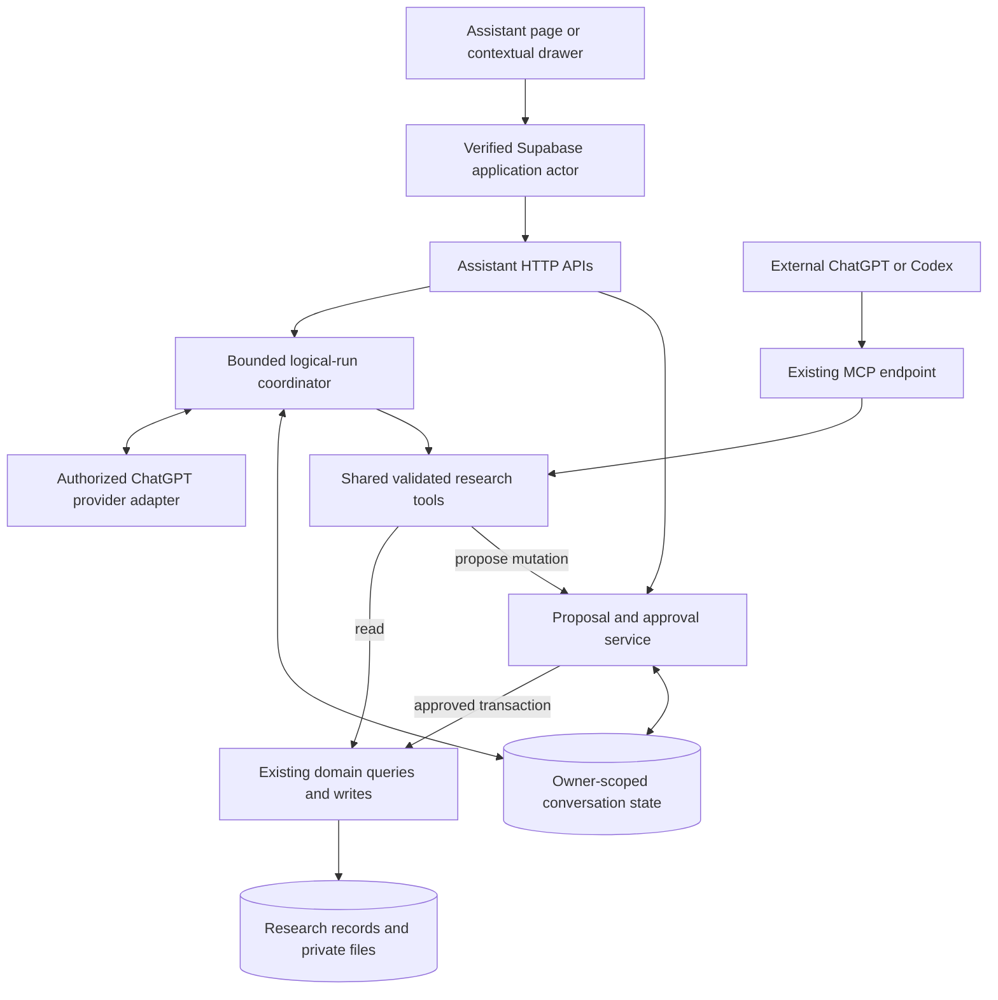

# Ask Sprig: full frontend and backend implementation plan

**Status:** Proposed implementation specification; application functionality is not yet implemented.  
**Prepared:** 16 November 2026.  
**Product:** PhD Companion, a private research workspace used by one scholar and hosted on Vercel.  
**Application baseline:** `master` at `cad160beb4981f8fa6f9bcbc561eb1081b6e45f4`.  
**Design baseline:** [interactive prototype and run instructions](prototypes/README.md), introduced in [PR #18](https://github.com/vijaybhaarath143/phd-companion/pull/18).  
**Scope:** Backend architecture, production frontend, API contracts, 14-step journey, all 42 designed UI cases, delivery sequence, and acceptance checks.

The prototype uses fictional records and simulated operations. Its connected states are design examples, not evidence that this hosted application has subscription access. This document defines the work needed to implement those behaviors.

## 1. Product outcome and operating model

The scholar can open Ask Sprig from any device, ask questions about her doctorate, inspect the supporting records, and approve specific changes to her journal or planner. She can return later to the same conversation, sources, pending proposal, and save receipt.

Use the existing Next.js application on Vercel and Supabase Auth, Postgres, and private Storage. Add a bounded chat service and shared research tools inside the same application. The initial release does not require an additional always-on server.

Model requests should use an authorized ChatGPT subscription connection through OAuth, consistent with the requested no-API-key operating model. **Verifying a permitted hosted integration for this deployment and intended subscriber is a release dependency.**

### First useful release

1. Answer “What needs my attention this week?” from current records.
2. Summarize unresolved feedback for a selected manuscript, with source links.
3. Turn existing feedback into an exact set of tasks after review and approval.
4. Create a journal entry from chat, preserving an unknown or month-only date.

Read-only experiment questions and evidence reading should reuse the current tool implementations. Build the other designed recovery states as the corresponding services become available; do not expose a button in production without its actual recovery behavior.

### Expansion after the core release

- Broader mutation coverage, including task status and manuscript phases.
- Search across indexed evidence-file contents.
- Independent multi-action workflows with individual receipts and partial recovery.
- Background ingestion or unattended work if usage demonstrates the need.

OCR, literature discovery, external research services, voice, and manuscript generation need separate capability and product decisions.

## 2. Existing foundations and work to add

| Area | Already present | Required addition |
| --- | --- | --- |
| Application | Next.js 16, React, TypeScript, Tailwind, shadcn/ui | Assistant page, navigation entry, optional contextual drawer |
| Identity | Supabase application sessions | Chat API verification and distinct model-connection status |
| Research access | `withUser()` and owner-scoped domain queries | Reuse for threads, messages, approvals, and tool execution |
| Tools | 28 registered MCP tools | Transport-independent registry and native execution policy |
| Writes | `src/server/writes.ts` and database history rules | Approval, expected-version checks, comprehensive execution receipts |
| Evidence | Signed browser uploads, verification, private reads | Attachment selection in chat and source metadata |
| Extraction | PDF, Word, spreadsheet, slide, CSV, and text extraction | Honest partial-read presentation; later extraction cache/search |
| Persistence | Research records, files, histories | Conversations, messages, logical runs, proposals/receipts, encrypted model connections |
| External assistant | Supabase OAuth and `/mcp` | Keep compatible while native chat invokes shared handlers internally |
| Design | Sprig artwork, product tokens, prototype | Rebuild as production components connected to real server state |

The current model is one doctorate overall, with publications/manuscripts and benchwork beneath it. New context selectors must not recreate the older multi-project hierarchy described in some historical documents.

## 3. Architecture and service boundaries



### Responsibilities

- **UI:** interaction, draft editing, event rendering, sources, approval previews, and recovery choices.
- **API layer:** session checks, request validation, ownership, CSRF/origin protection, and response formatting.
- **Run coordinator:** history assembly, inference, bounded tool loops, cancellation, checkpoints, and terminal states.
- **Provider adapter:** authorized model requests, model discovery, stream interpretation, refresh, and normalized errors.
- **Shared tools:** stable definitions and schemas, execution policy, domain calls, structured results, and provenance.
- **Approval service:** immutable proposed arguments, approval versioning, concurrency checks, atomic effects, and receipts.
- **Database:** ownership, cross-row consistency, single active run, uniqueness, durable history, and retry protection.

Do not hold a database transaction open while waiting for model output or user approval. Each read or write uses its own short transaction.

## 4. Model access and authentication

### 4.1 Three separate permissions

| Boundary | What it authorizes | What it does not authorize |
| --- | --- | --- |
| Supabase app session | Access to the scholar’s app records and chat history | Spending a ChatGPT plan |
| Existing Supabase MCP OAuth grant | An external assistant calling PhD Companion tools | Native model inference from PhD Companion |
| Authorized OpenAI model connection | Eligible inference using the selected account/plan | Access to another scholar’s records |

The backend derives the research actor from a verified app session. Neither the browser nor the model supplies an effective `owner_id`. A model-connection identity must never replace the Supabase actor.

Native chat must not send an ordinary browser token to `/mcp` or fabricate connector claims. Preserve the connector’s `client_id`, session, consent, and revocation checks.

### 4.2 Hosted subscription connection proof

The earlier architecture research identified OpenAI’s hosted-app access process as a prerequisite. Recheck the current documentation and obtain the contract permitted for the real application before implementing its registration/callback details.

The connection proof must establish:

1. The hosted deployment and intended subscriber are permitted to use plan-funded inference.
2. The application can complete the authorized OAuth flow.
3. Returned permissions include model usage, not identity-only sign-in.
4. The available model catalog can be read for that connection.
5. A small streamed request reaches terminal success.
6. Refresh, refusal, expired connections, revocation, and usage limits behave as expected.

Until then, real inference stays disabled. Development can use a deterministic fixture provider. The existing external MCP workflow can remain available separately. Do not silently switch to API billing.

### 4.3 Credential implementation

- Store encrypted access/refresh credentials in a private server-only repository.
- Keep the encryption secret outside the database storing ciphertext; record encryption version/key identifier for rotation.
- Expose only display status, permitted model choices, and safe recovery actions to the client.
- Bind each connection to a verified application account and provider account/workspace.
- Coordinate refresh with a lease or compare-and-swap version to avoid concurrent refresh-token reuse.
- Do not erase credentials during a transient network or provider outage.
- Treat confirmed revocation or terminal refresh errors as reconnect-required.
- Keep credentials out of messages, tool results, browser storage, public environment variables, exports, and logs.

Research queries continue through `withUser()`. The existing administrative `SUPABASE_SECRET_KEY` must not become a general chat credential. Design and review narrow database permissions for credential access separately from ordinary research-table grants.

## 5. Backend module plan

```text
src/server/tools/
  registry.ts              Names, descriptions, schemas, policy, handlers
  schemas.ts               Shared Zod contracts
  context.ts               Verified browser/connector actors and execution context
  results.ts               Structured data, sources, effects, safe errors
  handlers/
    journal.ts
    research.ts
    planner.ts
    academics.ts
    notes.ts
    files.ts

src/server/assistant/
  threads.ts               Thread listing, context, archive/rename, draft versions
  messages.ts              Ordered content blocks, pagination, checkpoints
  runs.ts                  State transitions, leases, deadlines, active-run slot
  runner.ts                Bounded inference/tool loop
  context.ts               Current record data and conversation assembly
  proposals.ts             Validated proposals, editing, hashes, versions
  approvals.ts             Approval, execution, receipts, rejection
  sources.ts               Ownership-checked source previews and locators
  schemas.ts               HTTP and stream contracts

src/server/ai/
  provider.ts              Narrow provider interface
  chatgpt.ts               Adapter for the authorized hosted contract
  connections.ts           Encrypted connection repository and refresh
  errors.ts                Provider errors mapped to product states
  fixtures.ts              Deterministic development/test behavior

src/server/mcp/server.ts    Thin adapter around the shared tools
```

Paths are proposed. Keep the current domain-query files and shared writes where they already fit. Read the repository’s current `AGENTS.md` and relevant bundled Next.js documentation before writing framework-specific code.

### 5.1 Shared tool registry

Extract existing handlers without changing the external MCP tool names or result shapes. Preserve current validation, partial dates, text limits, storage rules, retry handling, and history behavior.

Each registry entry defines its stable name, schema, description, read/write classification, native approval requirement, handler, and structured output. Generate MCP annotations from this definition where practical, while enforcing native approval independently on the server.

Initially expose a bounded native allowlist for the four release workflows. Refactoring the 28 existing tools does not require shipping all mutations in native chat on day one.

### 5.2 Existing feedback to tasks: add the missing domain operation

The prototype’s main workflow starts with feedback that already exists. The current `add_guide_feedback` tool records new feedback and can create tasks alongside it; using it to convert existing feedback would risk duplicating that feedback.

Add a shared domain operation, provisionally `createTasksFromFeedback`, and a native validated tool definition:

- Inputs identify existing feedback/journal source records, the manuscript, exact proposed tasks, and expected versions.
- The server verifies ownership and the manuscript/source relationships.
- Each task retains its source link; do not create a replacement feedback entry.
- Assign stable task IDs and a logical execution key when the proposal is persisted.
- Create the approved task set and its receipt in one transaction.
- Return the existing receipt on a repeated execution key.

Expose this new operation through MCP only as a deliberate later contract change. Keep the existing 28-tool connector compatible during the extraction.

### 5.3 Research rules to preserve

- Journal dates may be exact days, months, or unknown; never manufacture a day.
- Tasks currently accept an exact due day or no due day. A target such as November is a note, not a fake due date.
- Task dependency, manuscript phase, experiment revision, and submission-history rules remain in the domain/database layers.
- Reads compute current priorities and credit totals from the recorded data.
- The assistant receives neither arbitrary SQL nor shell/administrative capabilities.
- Third-party text in files or notes is data, not permission to change execution policy.

## 6. Data model and migrations

Use additive migrations. The following are logical fields, not final SQL definitions.

### 6.1 `chat_threads`

- `id`, `owner_id`, title, title source (`automatic` or `user`), timestamps.
- Context type and ID, restricted to supported record kinds or whole PhD.
- `archived_at`, `version`, and optional last-activity ordering key.
- A versioned draft payload: text, selected context, verified attachment IDs, and updated time.

Indexes support owner/activity pagination and active/archived views. Rename/archive/context updates use expected versions. Context changes during a live reply affect a subsequent turn, not the already executing request.

### 6.2 `chat_messages`

- `id`, `owner_id`, `thread_id`, stable sequence/order, role, timestamps.
- User message `client_message_id`, unique for the thread and actor.
- Ordered, typed content blocks: text, source reference, tool activity, proposal reference, receipt reference, or notice.
- Status such as accepted, streaming, complete, incomplete, or failed.
- Server-only provider items/tool-call correspondence needed to reconstruct a valid request history.

Public message projections must omit credentials and internal-only provider material. Render text safely; stored content is not trusted HTML.

### 6.3 `assistant_runs`

- `id`, owner/thread IDs, initiating message ID, selected connection/model.
- Logical status, attempt number, cancellation request, deadline, lease holder/expiry, timestamps.
- Last persisted event sequence/checkpoint and safe error category.

A logical run may span more than one HTTP request. For example, approval resumes a persisted run without resending its initiating user message. A database constraint/transactional slot allows one active run per thread, including an unresolved proposal.

### 6.4 `assistant_tool_calls`

- `id`, owner/run IDs, tool name, provider call ID where applicable.
- Proposed validated arguments, proposal version/hash, expected record versions, and sources.
- Stable execution key, approval decision/time, rejection time, status.
- Structured result, committed effects, and receipt ID/time.

The stored row acts as the mutation receipt. For database-only writes, commit the effects and successful receipt in the same transaction. Keep execution keys unique and enforce ownership on lookup.

### 6.5 Private model connections

Store connection ID, application owner, verified provider account/workspace, granted permissions, encrypted credential material, expiry, refresh version/lease, and lifecycle status behind narrow server access.

No normal client can enumerate these rows. The client-facing status repository returns a separate redacted projection.

### 6.6 Optional later document index

Add `document_chunks` only when cross-document search ships. Include owner, attachment ID, file hash, parser version, chunk index, text, completeness, offsets, and available page/sheet/slide locators.

### 6.7 Invariants and lifecycle

- Enforce owner consistency with composite foreign keys or equivalent checks, not just UI filtering.
- Keep one accepted user message per client submission key.
- Keep one execution receipt per approved mutation.
- Preserve append-only research history behavior.
- Include conversations, source references, proposals, and receipts in export; exclude credentials.
- Extend account deletion for chat, derived text, and model connections.
- Archiving a chat changes its visibility, not its research records or saved effects.
- Define chat retention before enabling production writes. Disabling the feature flag must preserve durable data for later recovery/export.

## 7. HTTP and streaming contracts

Use authenticated Next.js route handlers for streaming and resumable requests. Existing form-based areas may continue using server actions. Do not assume server-action origin protection automatically covers new APIs.

### 7.1 Proposed endpoints

| Method and route | Purpose and important behavior |
| --- | --- |
| `GET /api/assistant/threads` | Owner-scoped cursor pagination; active/archived filter and search |
| `POST /api/assistant/threads` | Create a conversation with verified optional context |
| `GET /api/assistant/threads/:id` | Messages, current logical run, pending proposal, and receipts |
| `PATCH /api/assistant/threads/:id` | Rename, archive/restore, or update future context using expected version |
| `PUT /api/assistant/threads/:id/draft` | Versioned draft autosave; never starts inference |
| `POST /api/assistant/threads/:id/messages` | Deduplicate submission, acquire run slot, and stream a bounded turn |
| `GET /api/assistant/runs/:id` | Latest committed progress and terminal state after reconnect |
| `POST /api/assistant/runs/:id/continue` | Resume the latest eligible interrupted reply without duplicating its user message |
| `POST /api/assistant/runs/:id/cancel` | Request cancellation of future work; preserve committed effects |
| `GET /api/assistant/tool-calls/:id` | Retrieve proposal or receipt; resolve an unknown save outcome |
| `PATCH /api/assistant/tool-calls/:id/proposal` | Validate edits, replace pending proposal version/hash, require fresh approval |
| `POST /api/assistant/tool-calls/:id/approve` | Execute the exact stored proposal once; return receipt or version conflict |
| `POST /api/assistant/tool-calls/:id/reject` | Reject pending proposal and release its active-run slot |
| `POST /api/assistant/tool-calls/:id/refresh` | Rebuild from current records after conflict; return a new pending version |
| `GET /api/assistant/sources/:kind/:id` | Access-checked source preview and current availability |
| `GET /api/assistant/connection` | Redacted model connection, model choices, and recovery status |
| `POST /api/assistant/connection/disconnect` | Revoke/disable future model use; retain app history |
| Authorized connection start/callback routes | Implement only after the permitted hosted OAuth contract is known |

Use existing signed-upload initiation/completion services for file bytes. Reuse domain handlers without calling cookie-bound server actions from an unrelated execution context.

### 7.2 Request rules

- Obtain the actor from the server session, not a body field.
- Validate body size, text length, attachment status, record kind/ID, and ownership.
- Accept a client submission UUID for message deduplication.
- Require expected proposal version/hash for editing or approving a proposal.
- Treat repeat approval of an already committed execution as a receipt lookup, not a second write.
- Protect cookie-authenticated mutations with appropriate origin/CSRF checks.
- Return JSON errors to API callers, not a sign-in HTML redirect.

Suggested application error categories include `app_session_expired`, `connection_required`, `connection_expired`, `usage_limit_reached`, `source_unavailable`, `active_run_exists`, `proposal_stale`, `validation_failed`, and `temporarily_unavailable`. These are application contracts, not claims about provider error-code names.

### 7.3 Stream event envelope

Each event includes a schema version, run ID, increasing sequence, event type, and typed payload. The client ignores duplicates for a run/sequence.

| Event | Frontend reaction |
| --- | --- |
| `run.started` | Acknowledge the accepted user message and enter active state |
| `tool.started` / `tool.completed` | Update concise activity labels |
| `message.delta` | Append text to the active assistant message |
| `source.available` | Add a source reference with a safe locator |
| `approval.required` | Show the persisted proposal; stop the request in awaiting-approval state |
| `run.completed` | Mark the reply complete after terminal provider success |
| `run.interrupted` / `run.failed` | Retain partial text, show incomplete status and supported recovery |
| `run.cancelled` | Keep prior text/effects and stop further work |

Use a real streaming decoder that handles event boundaries split across network chunks. Saving partial output is a bounded checkpoint operation, not a database write per token.

After a connection drop, fetch committed run state. Do not blindly replay the whole inference or a mutation. An interrupted stream containing text is still incomplete until success is confirmed.

## 8. Logical runs, budgets, and recovery

```text
queued -> running -> completed
                  -> awaiting_approval -> running -> completed
                  -> interrupted
                  -> failed
                  -> cancelled
                  -> limit_reached
```

1. Verify the actor, thread, and submitted context.
2. Deduplicate the message and acquire the active-run slot atomically.
3. Persist the initiating message, logical run, and fixed context snapshot.
4. Assemble necessary history and fresh source/tool data.
5. Resolve the authorized connection and available model.
6. Stream inference; execute permitted reads and persist tool results.
7. Persist any mutation proposal, finish the HTTP request, and wait without an open function.
8. On approval, use a fresh HTTP request and short transaction to execute the stored plan.
9. Persist the terminal result/receipt and release the active-run slot.

Set model-round, tool-call, retrieved-text, and execution-time budgets in the application. Keep a reserve below the deployed function deadline to persist interrupted state. Verify the actual deployment’s limits rather than assuming the existing MCP route’s 60 seconds applies to chat.

Cancellation is best effort for an in-flight provider request. Recheck the cancellation flag before starting another tool or mutation. Previously committed approved changes remain committed.

A run lease lets another request identify abandoned work. Check for existing committed receipts before deciding whether a failed attempt is safe to retry. The initial version does not promise background completion after every request ends.

Only resume the latest eligible partial reply when no later turn or active run conflicts with it. If the conversation has moved on, offer a new question with the earlier answer as context instead of silently branching its history.

## 9. Proposals, atomic writes, and provenance

### 9.1 Proposal lifecycle

```text
pending -> edited pending version -> approved/saving -> saved with receipt
        -> rejected
        -> stale -> refreshed pending version
        -> failed before commit -> safe retry
        -> outcome unknown to client -> receipt lookup
```

The client’s unknown outcome is distinct from an authoritative server status. The server may already have a successful receipt.

### 9.2 Approval transaction

1. Authenticate the application user and load the owned proposal.
2. If already committed, return its receipt.
3. Lock the proposal; verify pending status, proposal version/hash, and approval eligibility.
4. Recheck source access, relationships, expected record versions, and cancellation.
5. Run the domain operation with the proposal’s stable IDs/execution key.
6. Persist effects, approval metadata, receipt, and final run state in the same transaction.
7. Return committed record links and refresh affected page data.

The browser approves a stored proposal ID/version. It does not supply replacement execution arguments. Editing a proposal creates a new validated version requiring approval again.

### 9.3 Important distinctions

- A valid app session can approve an already prepared database write while the model connection is expired or disconnected. This operation need not call the model.
- The feedback-to-tasks bundle is all-or-nothing.
- A general workflow with separate independent operations can have partial results, each with its own receipt. Retry failed operations only.
- An explicit failure before commit may be retried with the same execution key.
- An unknown outcome requires receipt/status recovery before retry.
- A conflict requires a refreshed proposal and fresh approval.

Add trusted assistant provenance tied to run/tool-call IDs. If extending `created_via`/`changed_via`, update the database source functions, permitted values, UI labels, and tests together. Never let model input fabricate a connector identity or provenance value.

## 10. Evidence and context backend

### Initial implementation

- Start with existing record searches and targeted evidence reads.
- Verify that a source belongs to the scholar and is still available before returning its current body or using cached tool text in a new model request.
- Store references with record ID, record version or file hash, title, and available location.
- Do not persist a short-lived signed URL as a permanent citation; resolve the protected file route when opened.
- Reuse file type/size verification and private storage policies.
- The current extraction call returns at most 40,000 characters and can stop early. Preserve completeness and offset information.
- Current extraction does not provide OCR. Page citations require real preserved page boundaries; do not invent them from character counts.

For chat-only evidence not yet attached to a research record, define ownership and cleanup explicitly. A small owner-scoped chat attachment resource/private folder is preferable to inventing a research entry. Until that storage contract exists, enable selection of already verified evidence and mark new-file upload as unavailable.

### Historical sources

An unavailable source preview must not reveal its cached body. A historical answer may already contain information the scholar previously viewed; disabling a source does not automatically erase those message texts. Reauthorize source-backed tool data before reuse and document any future redaction requirement separately.

### Later indexed retrieval

Cache extraction by attachment hash and parser version. Start with owner-scoped Postgres full-text search over chunks. Recheck the attachment/parent’s current visibility on retrieval, including removed/replaced/trashed records. Derived text follows source retention and account deletion.

Introduce a worker when ingestion needs independent execution or repeatedly exceeds request budgets. A worker uses a narrow verified job context, not arbitrary caller-supplied owner IDs or unrestricted administrative access. Moving execution to a VM does not establish subscription eligibility.

## 11. Frontend information architecture and routes

Add **Ask Sprig** to the existing app navigation. Provide a full page for conversations; add a contextual entry point from a manuscript, experiment, or journal entry. An optional drawer uses the same conversation IDs and service as the full page.

Proposed routes:

- `/assistant`: inbox and selected conversation, or the first-conversation state.
- `/assistant/:threadId`: durable conversation URL, including the current proposal/receipt.
- Existing Settings: model connection status, reconnect/disconnect, and usage guidance.

The prototype reviewer strip, case selector, flow map, deterministic timers, and `pcFlowDemo` API are design tools. They are not production app controls.

### Layout behavior

- Desktop: existing app navigation, searchable conversation list, and selected thread.
- Narrow layouts: inbox or thread as a full-width view; Back restores the inbox row and search/scroll position.
- The prototype switches the inbox/thread arrangement around 680 pixels. Verify this against the production app shell and available content width before fixing the implementation breakpoint.
- Keep the composer, proposal actions, source close action, and error recovery reachable with a mobile keyboard open.
- A source peek occupies the thread area on narrow screens and returns to the same message/scroll position.
- Contextual drawer and full page must not create separate copies of a conversation.

Match the current product’s warm background, Leaf actions and saved states, Sky sources, Sun attention states, Grape manuscript context, rounded components, and Sprig artwork. Use existing production tokens/components rather than copying the prototype’s standalone CSS wholesale.

## 12. Frontend component plan

```text
src/app/(app)/assistant/
  page.tsx                         Initial inbox and empty selection
  [threadId]/page.tsx               Owned thread route
  loading.tsx                      Skeleton matching the final layout
  error.tsx                        Recoverable route-level failure

src/components/app/assistant/
  assistant-provider.tsx           Shared selection/drawer state and request lifecycle
  assistant-shell.tsx              Responsive inbox/thread composition
  inbox.tsx                       Grouped list, search, paging, archive filter
  conversation-row.tsx            Title, activity time, context, pending badge
  conversation-menu.tsx           Rename, archive, restore
  thread.tsx                      Messages, run status, source/proposal surfaces
  message-list.tsx                 Stable message ordering and scroll behavior
  message-content.tsx              Safe typed-block rendering
  composer.tsx                    Draft, send/stop, attachments, context
  context-picker.tsx              Whole PhD and owned record selection
  attachment-picker.tsx           Existing evidence and permitted uploads
  attachment-chip.tsx             Verification, failure, replacement, removal
  run-activity.tsx                 Tool and streaming progress
  source-chip.tsx                  Accessible citation control
  source-peek.tsx                  Loading, available, partial, unavailable source
  proposal-card.tsx                Exact proposed changes and actions
  proposal-editor.tsx              Included tasks, title/date edits, validation
  save-receipt.tsx                 Committed effects and record links
  connection-status.tsx            Setup, reconnect, unavailable, usage states
  recovery-notice.tsx              Specific actionable failures
  assistant-drawer.tsx             Optional contextual surface

src/lib/assistant/
  contracts.ts                    Shared public DTOs/event discriminated unions
  client.ts                       Typed HTTP requests and normalized errors
  stream.ts                       Streaming decoder and event-sequence handling
  reducer.ts                      Deterministic UI transitions
```

Follow the existing application conventions first. React context/reducers and focused hooks are sufficient initially; this feature does not require adopting a global state framework.

### 12.1 UI state axes

Keep related state separate rather than creating one giant global status:

| Axis | Examples |
| --- | --- |
| App identity | checking, signed in, expired |
| Model connection | unavailable, absent, connecting, ready, reconnect required, disconnected, limited |
| Inbox | loading, ready, empty, failed, filtered with no results |
| Thread | loading, readable, unavailable, archived |
| Run | idle, submitting, reading tools, streaming, awaiting approval, saving, complete, interrupted, failed |
| Source peek | closed, loading, readable, partial, unavailable, failed |
| Attachment | selected, uploading, verifying, ready, invalid, failed, removed |

The server owns run, approval, and receipt state. Local UI state projects those records; it does not decide that a save succeeded because an animation finished.

### 12.2 Data loading and drafts

- Load initial owned data using the existing server rendering/auth patterns.
- Cursor-page the inbox and older messages; do not fetch every conversation on each route change.
- Keep draft text/context/attachment IDs scoped to the signed-in user and thread.
- Debounce online draft autosave with a version. If another device changes the draft, preserve the local copy and ask which version to keep instead of silently overwriting it.
- An offline draft is unsent. Do not imply that inference is queued on the server.
- If the chosen draft storage is memory-only, explicitly avoid promising survival after tab close/reload. Durable online drafts restore from the server; stronger offline persistence is a separate implementation decision.
- Preserve the draft through model reconnect, usage limits, and same-account app reauthentication. Clear it on explicit logout/account change; never restore one account’s draft into another.

### 12.3 Composer and message behavior

- Enter sends; Shift+Enter inserts a newline. Ignore Enter during IME composition.
- Disable Send for empty input, invalid/unverified files, blocked connection/session state, an active reply, or an unresolved proposal in that thread.
- Use stable submission IDs and an accepted-message acknowledgement to avoid duplicates.
- Stop preserves partial output as incomplete. Continue/retry operates on the existing accepted message/run according to server eligibility.
- Never show a success state from text arrival alone; wait for terminal success.
- Preserve the reader’s scroll position when older messages load. Auto-scroll only if already following the latest reply; otherwise show a jump-to-latest affordance.
- Show specific failure recovery near the affected content, not only a transient toast.

### 12.4 Sources, context, and files

- Context selections name the specific manuscript, experiment, or journal entry.
- Context changes are visible and removable without discarding the draft.
- Source chips open an ownership-checked current preview with title, record type, date/precision, relationship, and available excerpt/locator.
- Unavailable sources show a clear explanation and no cached body. Allow removal from context.
- File chips show verification progress and specific format/size/read failures. Send only verified permitted attachment IDs.
- The existing browser evidence-upload limit is 20 MB; verify server configuration and real file type, not just the filename.
- Images/scans that cannot be read receive an explicit limitation. Partly read documents identify which content was read and which remains unread.

### 12.5 Proposal and receipt presentation

- Pending: show exact changes, sources, task links/context, included count, and due-day precision.
- Editing: validate included titles and exact-day inputs in place, preserve other edits, and make clear that saving edits is not approval.
- Approval: disable duplicate clicks while the request is in flight; retain the same execution identity across retries.
- Saved: show committed effects, current record links, approval time, and assistant provenance from the server receipt.
- Conflict: show the relevant changed data and ask for review of a refreshed proposal.
- Unknown result: check the receipt first; do not show a generic “try again” that can duplicate effects.
- Partial workflow: identify committed and failed independent operations; retry only the failed operations. Do not show a feedback/task bundle as partially committed.

### 12.6 Accessibility and responsive acceptance

- Use native controls, labelled inputs, visible focus, and sufficient text contrast.
- Return focus to the source chip, conversation row, or triggering control after closing/back navigation.
- Esc closes a peek/popover and safely declines/dismisses a connection review where appropriate.
- Manage focus inside modal permission/app-sign-in surfaces without trapping it in nonmodal panels.
- Announce meaningful run, validation, and save status through live regions; do not announce every token.
- Respect reduced motion and avoid layout jumps when progress changes.
- Test keyboard navigation, screen-reader output, touch targets, and actual mobile keyboard behavior. Prototype visual checks do not establish production accessibility compliance.

## 13. The 14-step journey and frontend/backend handoffs

| Step | Designed state | Frontend responsibility | Backend handoff / acceptance |
| --- | --- | --- | --- |
| 1 | Setup required | Readable inbox/history, clear setup action | Return app data plus redacted missing-connection status |
| 2 | Permission review | Launch authorized flow and retain return location/draft | Validate state/PKCE/callback contract; refusal changes no research data |
| 3 | Connection ready | Display actual authorized state and start-new action | Persist verified connection and granted capabilities |
| 4 | New chat | Empty state and grounded suggestions | Create owned thread with stable ID |
| 5 | Draft with context | Select manuscript and compose without losing text | Validate context; versioned draft save |
| 6 | Attach evidence | Select existing verified evidence or complete supported upload | Verify ownership, type/size, and verified status |
| 7 | Reply in progress | Tool activity, streamed text, Stop | Deduplicated message, leased run, bounded stream |
| 8 | Answer with sources | Completed answer and citation chips | Confirm terminal success; store messages/source references |
| 9 | Inspect source | Current excerpt, date precision, Back/Esc | Recheck access and return source projection |
| 10 | Proposed tasks | Three exact tasks and sources; nothing saved | Persist stable proposal and await approval |
| 11 | Edit proposal | Validate edits, retain source-month note | Persist a new pending proposal version; reapproval required |
| 12 | Saving | Lock duplicate approval; show genuine progress | Execute owned, version-checked transaction once |
| 13 | Saved receipt | Effects, record links, receipt, provenance | Return committed receipt and invalidate affected app data |
| 14 | Resume | Same history, sources, and receipt on return | Read persisted state; do not replay prior mutations |

## 14. Delivery work packages

| Package | Work and dependencies | Deliverable and exit criterion |
| --- | --- | --- |
| P0: access proof | Confirm hosted connection contract and intended subscriber; independent of most UI work | Authorized small request, refresh/limit/revoke checks, documented integration contract |
| P1: shared tools | Extract current handlers and define verified contexts | Existing MCP tool/isolation tests pass; native dispatcher calls identical domain logic |
| P2: chat persistence | Add threads/messages/runs/tool calls, indexes, owner policies, draft versions | Two-account tests cover every new table/reference; submission and run uniqueness proven |
| P3: read-only vertical slice | Implement APIs, provider interface/fixtures, inbox/thread/composer, stream decoder, source peeks | Priorities and manuscript summaries complete with sources, stop/retry, and saved history |
| P4: approved-write vertical slice | Existing-feedback task operation, proposal editor, concurrency, receipts, journal creation | Edited approval creates exactly the intended effects once; stale/unknown saves recover correctly |
| P5: complete frontend recovery | Setup/session/usage errors, inbox management, attachment failures, mobile/resume | All relevant 42 designed cases have real server-driven transitions and browser coverage |
| P6: release hardening | Export/deletion, logs, deadlines, accessibility, live authorized smoke checks | Feature-flagged production rollout and acceptance checklist pass |
| P7: optional extensions | Broader mutations, independent multi-action partial recovery, indexed document search/worker | Each extension has its own capability flag, ownership tests, and workload justification |

P1–P5 can be developed with provider fixtures while P0 is unresolved. Production inference depends on P0; mutation rollout additionally depends on P4/P6. If partial independent workflows are deferred, keep that UI case in the design review but do not expose that feature in the first production release.

### Suggested reviewable pull-request sequence

1. Shared registry extraction with MCP parity tests.
2. Additive chat schema and owner-scoped repositories.
3. Read-only APIs/run coordinator and deterministic provider fixtures.
4. Production inbox/thread/composer and source UI.
5. Approved feedback-to-tasks/journal operations, editor, receipts, conflicts, and retry tests.
6. Connection adapter and real status UI after the hosted contract is known.
7. Recovery/accessibility/export/deletion integration and staged enablement.

This is a dependency sequence, not a requirement for separate services or a large PR stack. Every review should contain a usable vertical slice or a clearly bounded enabling refactor.

### Effort and operational weight

The initial infrastructure remains small: the existing app/database/storage plus model requests. Development complexity is concentrated in authentication, durable streaming state, source visibility, and exactly-once logical effects.

The earlier 1–2 week estimate applies to a focused core release once model access is available, not to guaranteed completion of every designed extension. Treat full 42-case production hardening as additional scope, and refine estimates after P0/P1. External authorization timing is outside an engineering estimate.

## 15. Validation strategy

### Unit/contract tests

- Validate request bodies, typed event envelopes, tool schemas, proposal editing, and error mapping.
- Test stream parsing across split chunks, repeated events, incomplete endings, and terminal failure after text.
- Test frontend reducer transitions and draft preservation where they encode real behavior.
- Use deterministic provider fixtures for read, propose, refusal, truncation, limit, interruption, and delayed completion.

### Database integration tests

- Two accounts cannot cross-read/write any new row, source, receipt, attachment, or model connection projection.
- Cross-owner references and forged actor inputs fail.
- Repeated message IDs produce one accepted message.
- Concurrent approvals produce one receipt/effect set.
- Stale record versions and stale proposal versions fail before effects.
- Feedback-to-tasks creates three tasks linked to existing feedback, without duplicating feedback.
- Timeout recovery finds committed receipts; pre-commit failure safely retries.
- Archived threads retain history and saved effects; account deletion/export cover the new data.
- Current MCP contracts, disconnect behavior, and research-history tests remain green.

### End-to-end/browser checks

Implement the 14-step journey plus the 42-case matrix below. Prioritize real product buttons, keyboard flows, mobile back/focus, cross-device resume, duplicate approval, and recovery after an ambiguous save. Verify layouts at 360, 728, and 1000 pixels, plus a real small device/keyboard where possible.

Run the repository’s required checks against local/test services:

```bash
npm run typecheck
npm run lint
npm test
npm run build
```

Database tests need local Supabase. Do not seed or run destructive tests against production. Check the repository’s current instructions before running these commands.

The existing prototype has been browser-reviewed, but it is not a substitute for testing the production components and backend. Preparing this plan did not execute future application code or its acceptance suite.

## 16. Rollout, observability, and rollback

1. Apply additive schema changes in a test environment with synthetic records.
2. Enable fixture mode only in controlled development/test environments.
3. Complete the production hosted-access proof and protect connection credentials.
4. Enable native read-only chat for the intended scholar account.
5. Verify source correctness, access, interruption, and usage-limit recovery.
6. Enable reviewed mutation tools after receipt/conflict tests pass.
7. Expand file search or additional actions only after their individual gates pass.

Use server-side flags for native chat, approved writes, uploads, and later indexed search. Turning off writes must stop new executions and preserve existing receipts. Turning off inference should leave history/export available and provide explicit connection/service status.

Log IDs, tool names, durations, run outcomes, refresh outcomes, and safe error categories. Exclude research text, credentials, full request bodies, file bytes, and signed URLs. Monitor abandoned leases, incomplete streams, repeated conflicts, refresh failures, unknown-outcome recovery, and deadline exhaustion.

Rollback means disabling new capabilities and reverting compatible application code. Avoid dropping chat tables or undoing already approved research changes. Use existing export/backup procedures and a tested migration plan.

## 17. Release definition of done

- [ ] Hosted model connection is authorized and proven for the real deployment/account.
- [ ] Research/app identity remains separate from model billing identity.
- [ ] Current MCP connector remains compatible and revocable.
- [ ] Core questions produce supported, source-linked answers.
- [ ] Existing feedback converts to tasks without duplicated feedback.
- [ ] Journal month-only/unknown dates and task exact-day/unset dates are preserved.
- [ ] All native writes require approval of exact stored arguments.
- [ ] Duplicate submissions/approvals and ambiguous timeouts cannot duplicate effects.
- [ ] Conflicts require refreshed data and fresh approval.
- [ ] App sign-in recovery and model reconnect preserve the appropriate state.
- [ ] Sources and verified attachments respect current ownership/visibility.
- [ ] Draft, history, pending approval, and receipt behavior match the cross-device contract.
- [ ] Mobile keyboard, Back, focus restoration, reduced motion, and screen-reader flows are checked.
- [ ] Exports/deletion and operational logs include the right data and exclude credentials.
- [ ] Enabled UI controls correspond to implemented and tested server behavior.
- [ ] Required checks and targeted live smoke checks pass.

## 18. Implementation handoff brief

> Implement Ask Sprig in the existing PhD Companion Next.js/Supabase application, using the 14-step prototype and 42-case matrix as the UI contract. Preserve the current MCP connector while extracting its validated research handlers into a shared registry. Add owner-scoped conversation/run/proposal persistence, bounded streaming APIs, and production inbox/thread/composer/source components. Implement explicit approval with proposal versions, record concurrency checks, stable execution keys, and atomic receipts. For existing feedback-to-tasks, link to the existing feedback instead of recording it again. Keep task due dates exact or unset, and retain month-only targets as notes. Use provider fixtures until the actual hosted subscription integration is authorized; do not introduce an API-key billing fallback. Complete recovery, accessibility, export/deletion, and isolation checks before enabling writes.

## Appendix A. Complete UI case matrix

The following inventory is taken from the final prototype, with stable case IDs for design, implementation, and testing. A case represents a UI contract; its live backend behavior must be implemented before that capability is enabled.

### Setup (8)

| Case | Trigger | Frontend owner | Backend dependency | Expected result |
| --- | --- | --- | --- | --- |
| `setup-required` — Setup required | Open Ask Sprig before a model is connected | Connection status | GET connection | Existing inbox remains readable; setup CTA explains model connection and no API key. |
| `setup-unavailable` — Hosted access unavailable | Hosted plan access for this app isn't confirmed | Connection status | Hosted-access capability gate | Truthful hosted-access prerequisite, retain manual app and history access; no false promise that OAuth grants are available. |
| `setup-consent` — Connection permission review | Choose Set up connection | Connection review/return | Authorized OAuth start/callback | Simulated provider permission view, approve or decline; clearly demo flow. |
| `setup-declined` — Permission declined | Choose Decline on the permission page | Connection status + draft | Refused permission; preserve draft | Return to app without losing draft, reconnect can restart. |
| `setup-failed` — Connection failed | Approval callback doesn't complete | Connection recovery | Failed callback; safe retry | Retry/back and preserved draft; no credentials shown. |
| `setup-ready` — Demo connection ready | Approve demo access | Connection status + New | Verified grant and model catalog | Explicit simulated connected status and enter new chat. |
| `reauth` — Connection expired | Model connection expires while a proposal waits | Reconnect notice | Refresh lifecycle; owned proposal remains readable | Reconnect; existing conversation and pending proposal preserved. |
| `disconnected` — Connection disconnected | Choose Disconnect in the connection menu | Connection status | Disable/revoke model use; retain history | Stop new inference; history remains available and reconnect works. |

### Inbox (6)

| Case | Trigger | Frontend owner | Backend dependency | Expected result |
| --- | --- | --- | --- | --- |
| `inbox-loading` — Loading conversations | Open the inbox on a slow network | Inbox skeleton | GET threads and retry | Bounded skeleton then retry/load action. |
| `inbox-empty` — First conversation | First visit with no conversations | Empty inbox + New | GET threads returns an actual empty list | Empty inbox, supportive suggestions, New chat. |
| `inbox-populated` — Conversation inbox | Return with existing conversations | Inbox + thread | Paginated owned threads/messages | Existing styled list, switching, selected context, pending approval badge. |
| `search-empty` — No search results | Search for a term with no matches | Inbox search | Owner-scoped search; clear filter | Clear search restores list without deleting data. |
| `conversation-actions` — Rename and archive | Open a conversation's More actions | Conversation menu | PATCH title/archive; list/restore | Real local rename, archive, archived list and restore; no misleading permanent deletion. |
| `history-unavailable` — History unavailable | Conversation history request fails | History recovery | Typed read failure; retry existing thread | Retry and preserved local draft; distinguish failure from empty inbox. |

### Chat (9)

| Case | Trigger | Frontend owner | Backend dependency | Expected result |
| --- | --- | --- | --- | --- |
| `new-chat` — New chat and context | Choose New | Empty thread + context picker | POST thread and validate optional context | Choose whole PhD/manuscript/experiment/journal context; suggestion chips. |
| `draft-context` — Draft and context change | Type, then change context or switch conversation | Composer + context picker | Versioned draft/context updates | Draft preserved across picker changes and inbox navigation; remove context. |
| `reply-streaming` — Reply in progress | Send a question | Run activity + message list | Accepted message and ordered stream events | Show tool activity/streamed text, Stop works, no premature completed claim. |
| `reply-complete` — Answer with sources | Reply finishes | Message content + sources | Terminal success and persisted sources | Read-only priorities with record links and honest evidence grounding. |
| `reply-stopped` — Stopped reply | Press Stop while Sprig writes | Partial message + Continue | Cancel/continue latest eligible logical run | Partial text retained as incomplete; continue/retry creates no duplicate sent message. |
| `reply-failed` — Reply interrupted | Model stream drops mid-reply | Incomplete message + Retry | Persisted interruption and safe continuation | Partial response/error, recover; no successful completion label. |
| `offline` — Offline | Device loses network before sending | Composer + recovery notice | No message accepted until explicit send | Preserve unsent draft, retry explicitly; don't imply server queued it. |
| `limit-reached` — Usage limit reached | Plan usage limit is hit | Usage notice | Provider-limit mapping; no billing fallback | Pause model requests, preserve history; manage usage simulated; no paid fallback. |
| `session-expired` — App sign-in expired | PhD Companion sign-in expires | App sign-in return | Restore same-account session/thread/draft | Return to simulated sign-in then same thread/draft; not same as model reconnect. |

### Sources and files (6)

| Case | Trigger | Frontend owner | Backend dependency | Expected result |
| --- | --- | --- | --- | --- |
| `source-peek` — Inspect source record | Select a source chip | Source peek | GET authorized source preview | Title/date/precision/excerpt/linked manuscript; close/Esc focus return. |
| `source-unavailable` — Source removed or unavailable | Open a source that was moved to Trash | Unavailable source peek | Recheck access; withhold source body | Do not reveal cached text; return to chat, can remove inaccessible context. |
| `attach-evidence` — Attach evidence | Choose Attach | Attachment picker/chips | Owned verified evidence; supported signed upload | Choose demo stored file or local filename-only picker; removable chips. |
| `attachment-invalid` — Invalid or oversized file | Pick an unsupported or over-20 MB file | File error/chip | Type/size/verification validation | Helpful inline errors and pick/remove action; 20MB browser upload limit, format checks. |
| `file-unreadable` — Unreadable or image-only source | Ask about an image-only scan | Source limitation + picker | Extraction failure or image-only result | No fabricated extraction or OCR; choose another source. |
| `file-partial` — Document partly read | Ask about a 186-page PDF | Partial-source notice | Completeness/locator metadata and bounded next read | Show limitation and specific available portion; request more as simulated action. |

### Approvals (10)

| Case | Trigger | Frontend owner | Backend dependency | Expected result |
| --- | --- | --- | --- | --- |
| `proposal-pending` — Proposed record changes | Ask Sprig to turn feedback into tasks | Proposal card | Persist exact validated plan; awaiting approval | Exact three proposed tasks, source links, no writes before approval. |
| `proposal-edit` — Edit proposal | Choose Edit on the proposal | Proposal editor | PATCH pending version; fresh approval required | Change title/select tasks/exact due day or no due day; source month only retained as note, not fake task due date. |
| `proposal-invalid` — Proposal validation error | Save edits with a blank title or nothing selected | Editor validation | Reject invalid edits without dropping valid fields | Blank title or no selection; errors preserve other edits and are actionable. |
| `proposal-rejected` — Decline proposal | Choose Decline | Rejected proposal | Reject; release run slot; no effects | Nothing saved, review again/change request. |
| `proposal-saving` — Saving approved changes | Choose Approve | Saving card | Single owned approval transaction and execution key | Disable duplicate approval while saving; deterministic settlement. |
| `proposal-saved` — Saved changes and receipt | Save finishes | Receipt + saved-record links | Committed result and provenance | Three saved tasks with links, assistant provenance, single receipt. |
| `proposal-conflict` — Record changed elsewhere | Manuscript tasks change on another device | Conflict comparison | Version conflict; refresh and reapprove | Compare relevant old/current values; review refreshed proposal and approve again. |
| `proposal-save-failed` — Save failed before commit | Server error before anything is written | Save recovery | Explicit pre-commit failure; same-key retry | Clear nothing saved and safe retry with same logical IDs. |
| `proposal-unknown` — Save outcome unknown | Connection drops after approving | Receipt recovery | GET call/receipt before deciding to retry | Checking receipt recovery; never blindly duplicate effects. |
| `proposal-partial` — Partly saved workflow | Three independent changes; one fails | Independent-operation results | Per-operation receipts; retry failed only | Only for separate independent writes: show saved vs failed with retry failed only; avoid claiming atomic feedback task bundle partially committed. |

### Resume and mobile (3)

| Case | Trigger | Frontend owner | Backend dependency | Expected result |
| --- | --- | --- | --- | --- |
| `resume-pending` — Return to pending approval | Open the thread on another device | Thread + pending proposal | GET persisted proposal; no auto-execution | Same proposal restored in another demo session/device; no automatic approval. |
| `resume-complete` — Resume saved conversation | Come back to a saved conversation | Thread + saved receipt | GET messages/receipt; no replay | Existing sources/receipt retained; no replay of prior writes. |
| `mobile-navigation` — Mobile inbox and thread | Use Ask Sprig on a phone | Responsive inbox/thread | Same routes/data; retain selection and scroll | Back restores list, selecting opens full thread with reachable composer/actions. |


## Appendix B. Sources and implementation references

- [Prototype walkthrough and local run instructions](prototypes/README.md).
- [Prototype source](prototypes/chat-flow.html).
- [Prototype PR #18](https://github.com/vijaybhaarath143/phd-companion/pull/18).
- [Reviewed application baseline](https://github.com/vijaybhaarath143/phd-companion/tree/cad160beb4981f8fa6f9bcbc561eb1081b6e45f4).
- [Existing MCP tools](https://github.com/vijaybhaarath143/phd-companion/blob/cad160beb4981f8fa6f9bcbc561eb1081b6e45f4/src/server/mcp/server.ts).
- [Shared writes](https://github.com/vijaybhaarath143/phd-companion/blob/cad160beb4981f8fa6f9bcbc561eb1081b6e45f4/src/server/writes.ts).
- [Database actor boundary](https://github.com/vijaybhaarath143/phd-companion/blob/cad160beb4981f8fa6f9bcbc561eb1081b6e45f4/src/server/db.ts).
- [Connector authentication](https://github.com/vijaybhaarath143/phd-companion/blob/cad160beb4981f8fa6f9bcbc561eb1081b6e45f4/src/server/mcp/auth.ts).
- [Evidence extraction](https://github.com/vijaybhaarath143/phd-companion/blob/cad160beb4981f8fa6f9bcbc561eb1081b6e45f4/src/server/mcp/extract.ts).

Provider/hosting references from the architecture research follow. Recheck them against the actual approved integration at implementation time; the prototype does not establish account eligibility.

- [Sign in with ChatGPT: integration scope](https://developers.openai.com/siwc/token-sharing-open-source).
- [Integration quickstart](https://developers.openai.com/siwc/quickstart).
- [Models and inference](https://developers.openai.com/siwc/token-sharing-open-source/models-and-inference).
- [Capability limitations](https://developers.openai.com/siwc/token-sharing-open-source/preview-limitations).
- [Connection and inference errors](https://developers.openai.com/siwc/token-sharing-open-source/errors-and-recovery).
- [Vercel function duration](https://vercel.com/docs/functions/configuring-functions/duration).

